# Мониторинг аномалий в работе терминалов

<p align="center"></p>

Суточный контроль парка POS-терминалов, киосков и банкоматов: детектор находит дни,
когда устройство резко потеряло объём операций, замолчало или начало массово отказывать.
Задача не «предсказать поломку», а заметить отклонение в день, когда оно случилось —
пока простой не превратился в неделю и в неустойку по SLA.

Данные синтетические: генератор закладывает известные аномалии, поэтому качество
детектора измеряется точностью и полнотой, а не «на глаз».

## Результат на данных по умолчанию

120 устройств, 60 дней, 7 200 суточных наблюдений, 43 заложенные аномалии:

| Показатель | Значение |
| --- | ---: |
| Алертов выдано | 53 |
| Полнота (recall) | 100 % |
| Точность (precision) | 81 % |
| Алертов высокого приоритета | 20 |
| Устройств с алертами | 41 |

По классам: рост объёма — 16, рост доли отказов — 15, падение объёма — 11,
полный простой — 11. Ложные срабатывания — всплески на волатильных устройствах,
где естественный разброс подходит к порогу.

## Как работает

```
база  = медиана того же дня недели за 4 недели     (устойчива к выбросам)
разброс = MAD прошлых относительных отклонений     (точка разрушения 50 %)
алерт  = |отклонение| ≥ 40/55 %  И  |z| ≥ 3,5
```

Плюс жёсткое правило: падение больше 55 % проверяется всегда, даже если устройство
волатильное и z не дотягивает до порога.

Обоснование выбора — `docs/methodology.md`: почему не «среднее ± 2 сигмы», почему
сравнение идёт с тем же днём недели, откуда взялся порог 55 %.

## Быстрый старт

Python 3.10+ (проверено на 3.14), внешних пакетов нет.

```powershell
python src/generate_series.py
python src/detect.py
python src/report.py
```

Результат: `data/processed/alerts.csv`, `alerts_by_kind.csv`, `alerts_by_device.csv`,
`reports/dashboard.html`, `reports/summary.md`.

Тесты:

```powershell
python -m unittest discover -s tests -v
```

## Структура

```
src/generate_series.py  суточные ряды с профилем выходных, трендом и заложенными аномалиями
src/detect.py           EWMA-free детектор: медиана по дню недели + MAD + двойной порог
src/report.py           HTML-дашборд и markdown-резюме
tests/test_detector.py  8 тестов: полнота, точность, отсутствие реакции на ровный ряд и выходные
docs/methodology.md     методика и обоснование порогов
```

## Принятые решения

- **Сравнение с собой, а не с парком.** Киоск на 320 операций и POS на 145 несравнимы;
  норма у каждого устройства своя.
- **Медиана вместо среднего.** Один день простоя не должен сдвигать норму на неделю вперёд.
- **Учёт дня недели.** Иначе каждый выходной — «аномалия», и детектор перестают читать.
- **Двойной порог.** Только z — ловит шум; только проценты — пропускает волатильные устройства.
- **SILENT один раз на серию.** Недельный простой — один алерт с длительностью, а не семь.
- **Эталон в тестах.** Полнота проверяется по заложенным аномалиям, а не по ощущениям.

## Ограничения

- Календарь праздников не учитывается: 1 января даст SILENT по всему парку.
- Анализируются только счётчики; коды ошибок и логи — следующий слой диагностики.
- Детектор не различает «касса не работала» и «касса работала, но операции не проводились».

## Графика в дашборде

Алерты по дням (все и высокого приоритета) и донат классов аномалий, плюс анимированные
счётчики. Инлайновый SVG без библиотек; анимация отключается настройкой
`prefers-reduced-motion`.
